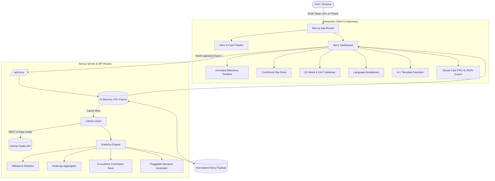

# GitStory 📖⚡

[](LICENSE)
[](https://nextjs.org/)
[](https://www.typescriptlang.org/)
[](https://tailwindcss.com/)
[](https://vitest.dev/)
[](Dockerfile)

> **GitStory** turns any public GitHub repository URL into an engaging, interactive "story" of its engineering history. Analyze commit velocity, contributor growth, release milestones, and code churn through animated visual timelines, race charts, heatmaps, and AI-crafted biographies.

---

## ✨ Features

- 📜 **Animated Milestone Timeline:** Auto-detects genesis commits, century milestones (`#100`, `#500`, `#1,000`), megacommit overhauls, hibernation gaps, and major version releases (`v1.0.0`).
- 🏁 **Dynamic Contributor Bar Race:** Scrub or play back monthly contributor epochs to watch maintainer leaderboards shift over the lifetime of the project.
- 🗓️ **Commit Rhythm Heatmaps:** GitHub-style 52-week calendar grid and 24x7 punchcard matrix revealing peak coding hours and night-owl coding patterns.
- 📊 **Architecture & Language Evolution:** Interactive breakdown of repository languages with authentic GitHub color palettes and byte counts.
- 🤖 **Multi-Tone Narrative Biographer:** Pluggable LLM interface generating biographies in **Storyteller**, **Tech Chronicle**, or **Humorous Hacker** tones (with instant statistical template fallback when no API key is provided).
- 🏷️ **Repository Accolades:** Earned badges such as *Century Club*, *Speed Demon*, *Night Owl Squad*, *Weekend Warrior*, and *Global Village*.
- 📤 **Export & Social Sharing:** One-click 1200×630 retina-ready social preview card PNG generator, complete JSON analytics download, and direct shareable URLs (`/story/[owner]/[repo]`).

---

## 🏗️ Architecture & Data Flow



---

## 🚀 Quick Start

### Prerequisites
- Node.js 18.x, 20.x, or 24.x
- npm, yarn, or pnpm

### 1. Clone & Install
```bash
git clone https://github.com/your-username/gitstory.git
cd gitstory
npm install
```

### 2. Configure Environment (Optional)
```bash
cp .env.example .env.local
```

| Variable | Description | Default |
| :--- | :--- | :--- |
| `GITHUB_TOKEN` | Personal Access Token to raise rate limit from 60 to 5,000 req/hr | Unauthenticated (60 req/hr) |
| `GEMINI_API_KEY` | Optional key for Gemini AI narrative generation | Falls back to statistical template |
| `OPENAI_API_KEY` | Optional key for OpenAI GPT-4o-mini narrative generation | Falls back to statistical template |

### 3. Run Development Server
```bash
npm run dev
```
Open [http://localhost:3000](http://localhost:3000) in your browser.

---

## 🧪 Testing & Validation

```bash
# Run unit tests (Analytics, Milestones, Heatmap, URL parsers)
npm run test

# Run TypeScript strict typecheck
npm run typecheck

# Run Next.js production build
npm run build

# Run Playwright End-to-End tests
npm run test:e2e
```

---

## 🐳 Docker Deployment

### Run with Docker Compose
```bash
docker-compose up --build
```
The application will be accessible at [http://localhost:3000](http://localhost:3000).

### Build & Run Docker Image Directly
```bash
docker build -t gitstory .
docker run -p 3000:3000 -e GITHUB_TOKEN=your_token gitstory
```

---

## ▲ Deploy to Vercel

Deploy GitStory with one click to Vercel:

[](https://vercel.com/new/clone?repository-url=https%3A%2F%2Fgithub.com%2Fyour-username%2Fgitstory)

1. Connect your GitHub repository to Vercel.
2. In **Environment Variables**, optionally supply `GITHUB_TOKEN` and `GEMINI_API_KEY`.
3. Deploy! Next.js App Router API routes and dynamic pages will be provisioned on Edge/Serverless functions automatically.

---

## 🗺️ Roadmap

- [x] Initial commit & genesis milestone tracking
- [x] Monthly contributor animated bar race chart
- [x] 24x7 day/hour punchcard & 52-week calendar heatmaps
- [x] Pluggable narrative engine with 3 customizable tones
- [x] 1200x630 social media PNG card rasterization
- [ ] Pull request velocity & merge latency breakdown
- [ ] Multi-repository comparative battle mode (e.g., `vuejs/core` vs `facebook/react`)
- [ ] Spotify Wrapped-style animated audio-visual recap mode

---

## 📄 License & Community

- Distributed under the [MIT License](LICENSE).
- Check out [CONTRIBUTING.md](CONTRIBUTING.md) to get involved.
- Read our [Code of Conduct](CODE_OF_CONDUCT.md).

