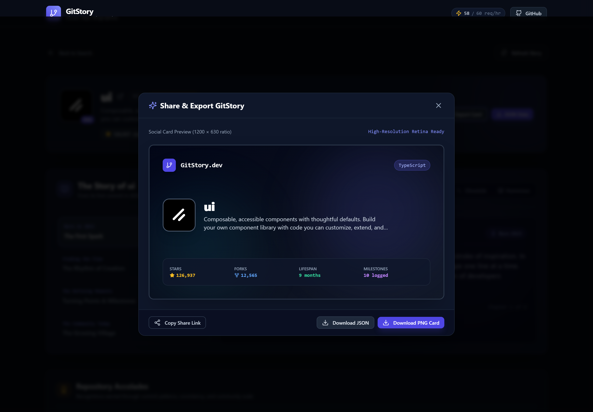
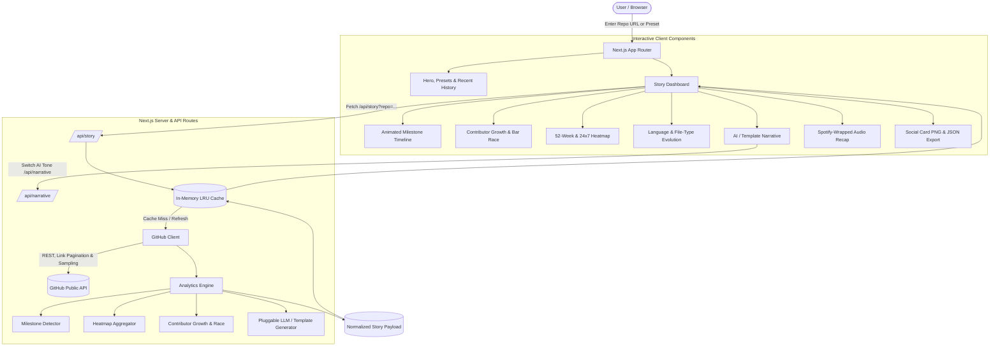

# GitStory 📖⚡

[](LICENSE)
[](https://nextjs.org/)
[](https://www.typescriptlang.org/)
[](https://tailwindcss.com/)
[](https://vitest.dev/)
[](Dockerfile)

> **GitStory** turns any public GitHub repository URL into an engaging, interactive "story" of its engineering history. Analyze commit velocity, contributor growth, release milestones, and code churn through animated visual timelines, race charts, heatmaps, AI-crafted biographies, and a Spotify Wrapped-style audio recap.

---

## 📸 Preview



> *Demo GIF placeholder — drop an animated walkthrough recording (`docs/demo.gif`) here.*

---

## ✨ Features

- 📜 **Animated Milestone Timeline:** Auto-detects true genesis commits, century milestones (`#100`, `#500`, `#1,000`), megacommit overhauls, hibernation gaps, peak sprint velocity, and version releases (`v1.0.0`).
- 🏁 **Contributor Growth & Bar Race:** Scrub or play back monthly contributor leaderboards alongside a cumulative Recharts contributor growth area chart.
- 🗓️ **Commit Rhythm Heatmaps:** Accessible 52-week calendar grid (auto-anchored even for archived repos) and 24x7 punchcard matrix revealing peak coding hours.
- 📊 **Architecture & File-Type Evolution:** Stacked language distribution bar plus Recharts file-type churn evolution across commit epochs.
- 🤖 **Multi-Tone AI Narrative Biographer:** Pluggable LLM interface (`Gemini` / `OpenAI`) generating biographies in **Storyteller**, **Tech Chronicle**, or **Humorous Hacker** tones, with zero-key statistical template fallback.
- 🎉 **GitStory Wrapped Mode:** Full-screen auto-advancing slide reel with confetti bursts and zero-dependency Web Audio API synthwave soundscapes.
- 🏷️ **Repository Accolades:** Earned badges including *Century Club*, *High Velocity*, *Night Owl Squad*, *Weekend Warrior*, *Release Factory*, *Global Village*, *Megacommit Legend*, and *Comeback Kid*.
- 📤 **Export & Social Sharing:** Retina 1200×630 PNG social preview card generator, JSON analytics download, and shareable deep links (`/story/[owner]/[repo]`).

---

## 🏗️ Architecture & Data Flow



---

## 🚀 Quick Start

### Prerequisites
- Node.js 22.x or 24.x (`>=20.9.0`)
- npm

### 1. Clone & Install
```bash
git clone https://github.com/yashwantraj147-eng/gitstory.git
cd gitstory
npm install
```

### 2. Configure Environment (Optional)
Create `.env.local` for local development (or pass `-e` / `.env` when using Docker):
```bash
cp .env.example .env.local
```

| Variable | Description | Default |
| :--- | :--- | :--- |
| `GITHUB_TOKEN` | Personal Access Token to raise rate limit from 60 to 5,000 req/hr | Unauthenticated (60 req/hr) |
| `GEMINI_API_KEY` | Optional key for Gemini AI narrative generation (`GEMINI_MODEL` defaults to `gemini-2.5-flash`) | Falls back to statistical template |
| `OPENAI_API_KEY` | Optional key for OpenAI narrative generation (`OPENAI_MODEL` defaults to `gpt-4o-mini`) | Falls back to statistical template |

### 3. Run Development Server
```bash
npm run dev
```
Open [http://localhost:3000](http://localhost:3000) in your browser.

---

## 🧪 Testing & Validation

```bash
# Run ESLint
npm run lint

# Run TypeScript strict typecheck
npm run typecheck

# Run unit tests (Analytics, Milestones, Heatmap, Parsers, API)
npm run test

# Run unit test coverage report
npm run test:coverage

# Run Next.js production build
npm run build

# Run Playwright End-to-End tests
npm run test:e2e
```

---

## 🐳 Docker Deployment

### Run with Docker Compose
```bash
docker compose up --build
```
The application will be accessible at [http://localhost:3000](http://localhost:3000).

### Build & Run Docker Image Directly
```bash
docker build -t gitstory .
docker run -p 3000:3000 -e GITHUB_TOKEN=your_token gitstory
```

---

## ▲ Deploy to Vercel

Deploy GitStory with one click to Vercel:

[](https://vercel.com/new/clone?repository-url=https%3A%2F%2Fgithub.com%2Fyashwantraj147-eng%2Fgitstory)

1. Connect your GitHub repository to Vercel.
2. In **Environment Variables**, optionally supply `GITHUB_TOKEN` and `GEMINI_API_KEY` / `OPENAI_API_KEY`.
3. Deploy! Next.js App Router API routes and dynamic pages will be provisioned automatically.

---

## 🗺️ Roadmap

- [x] Initial commit & true genesis milestone tracking on sampled repos
- [x] Monthly contributor animated bar race & growth curve chart
- [x] 24x7 day/hour punchcard & 52-week calendar heatmaps (active & archived repos)
- [x] Language & file-type churn evolution timeline
- [x] Pluggable AI narrative engine with 3 customizable tones
- [x] Spotify Wrapped-style animated audio-visual recap mode
- [x] 1200x630 social media PNG card rasterization
- [ ] Pull request velocity & merge latency breakdown
- [ ] Multi-repository comparative battle mode (e.g., `vuejs/core` vs `facebook/react`)

---

## 📄 License & Community

- Distributed under the [MIT License](LICENSE).
- Check out [CONTRIBUTING.md](CONTRIBUTING.md) to get involved.
- Read our [Code of Conduct](CODE_OF_CONDUCT.md).
